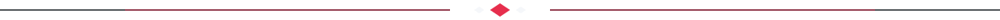
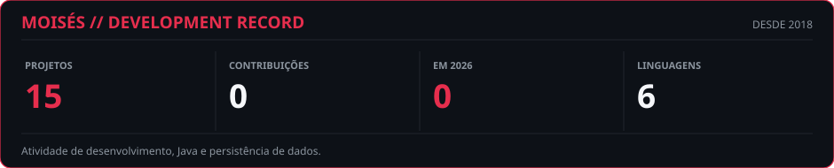
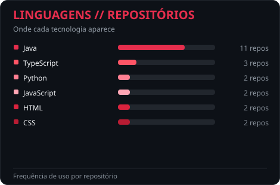

<!--
  ============================================================
  MOISÉS // PERFIL GITHUB
  VERSÃO: 2.0
  USUÁRIO: moisesssbarbosa
  TEMA: ZENLESS ZONE ZERO / ELLEN JOE

  CODAR // AUTOMATIZAR // CONSTRUIR // EVOLUIR

  Assets: ./assets/
  ============================================================
-->

 

<!-- STATUS DO SISTEMA: GRADE DE 4 COLUNAS -->

<table width="100%">
<tr>
<td width="25%" align="center"></td>
<td width="25%" align="center"></td>
<td width="25%" align="center"></td>
<td width="25%" align="center"></td>
</tr>
</table>

<!-- INTRODUÇÃO ANIMADA -->

 

<!-- ACESSO RÁPIDO -->

 

  NAVEGAÇÃO RÁPIDA // SELECIONE UM DESTINO
    
  
  
  
  
  
  

 

<!-- ======================================================= -->
<!-- 01 // DOSSIÊ DO OPERADOR                                 -->
<!-- ======================================================= -->

## `01 // DOSSIÊ DO OPERADOR` IDENTIDADE & CONTEXTO

<table width="100%">
<tr>

<td width="45%" valign="top">

<h3>🦈 Informações do Operador</h3>

<pre><code>const operador = {
  nome: "Moisés Barbosa",
  github: "moisesssbarbosa",
  classe: "Desenvolvedor em Formação",
  localizacao: "Brasil",

  foco: [
    "Engenharia de Software",
    "Desenvolvimento Backend",
    "Aplicações Web & Desktop",
    "Design Vetorial"
  ],

  status: "Estudando & Construindo"
};</code></pre>

</td>

<td width="55%" valign="top">

<h3>⚡ Sobre Mim</h3>

E aí! Eu sou o <b>Moisés</b>.

Sou um desenvolvedor em formação focado em construir uma base sólida em programação, arquitetura de sistemas e bancos de dados. Mesmo estando no início da jornada profissional, acredito em aprender colocando a mão na massa e estruturando projetos reais.

Transito entre o desenvolvimento backend com <b>Java</b> e <b>Node.js</b>, interfaces web modernas com <b>React</b> e <b>TypeScript</b>, além da modelagem e persistência de dados relacionais.

<b>Objetivo atual:</b> 
Evoluir continuamente minhas habilidades técnicas, construir sistemas úteis e consolidar um portfólio limpo e bem estruturado.

</td>

</tr>
</table>

<!-- GRADE DE ESPECIALIZAÇÃO -->

<table width="100%">
<tr>
<td width="25%" align="center"></td>
<td width="25%" align="center"></td>
<td width="25%" align="center"></td>
<td width="25%" align="center"></td>
</tr>
</table>

> 🦈 **Código limpo, lógica bem estruturada e atenção aos detalhes.**

<!-- ======================================================= -->
<!-- 02 // ARSENAL TECNOLÓGICO                                -->
<!-- ======================================================= -->

## `02 // ARSENAL TECNOLÓGICO` LINGUAGENS, FRAMEWORKS & FERRAMENTAS

### `TECNOLOGIAS PRINCIPAIS`

 

<!-- BANCO DE DADOS EXPANSÍVEL -->

<b>🛠️ EXPANDIR BANCO DE DADOS DE TECNOLOGIAS</b>

 

| Categoria | Tecnologias & Conhecimentos |
|:---|:---|
| **Backend & Lógica** | Java, Node.js, Programação Orientada a Objetos (POO), Estruturas de Dados, APIs REST |
| **Frontend & Web** | React, JavaScript, TypeScript, HTML5, CSS3 |
| **Bancos de Dados** | PostgreSQL, MySQL, SQL, Modelagem Relacional, Persistência de Dados |
| **Versionamento & Ambiente** | Git, GitHub, GitHub Actions, VS Code, Linux |
| **Design & Criação Visual** | Affinity Designer, Vetorização, Identidade Visual, UI |

 

<!-- ======================================================= -->
<!-- 03 // MISSÕES ATUAIS                                     -->
<!-- ======================================================= -->

## `03 // MISSÕES ATUAIS` PROJETOS & EXPERIMENTOS

TRABALHOS SELECIONADOS // SISTEMAS E ESTUDOS PRÁTICOS

 

<table width="100%">
<tr>
<td width="50%" valign="top">
  <h3>☕ Sistemas Desktop & Backend</h3>
  
Desenvolvimento de aplicações focadas em regras de negócio bem definidas, validação de entradas e integração com bancos de dados relacionais.

  <ul>
    <li>Arquitetura organizada e tratamento de exceções</li>
    <li>Consultas SQL otimizadas e controle de estoque/vendas</li>
  </ul>
  <code>Java</code> <code>PostgreSQL</code> <code>MySQL</code>
    
  
</td>
<td width="50%" valign="top">
  <h3>⚛️ Aplicações Web Modernas</h3>
  
Construção de interfaces responsivas e serviços web utilizando o ecossistema JavaScript/TypeScript.

  <ul>
    <li>Componentização e gerenciamento de estado</li>
    <li>Integração entre front-end e APIs</li>
  </ul>
  <code>React</code> <code>TypeScript</code> <code>Node.js</code> <code>JavaScript</code>
    
  
</td>
</tr>
</table>

 

<!-- ======================================================= -->
<!-- 04 // MÉTRICAS DO GITHUB                                 -->
<!-- ======================================================= -->

## `04 // MÉTRICAS DO GITHUB` ATIVIDADE & LINGUAGENS

  

 

<table width="100%">
  <tr>
    <td width="50%" align="center" valign="top">
      
    </td>
    <td width="50%" align="center" valign="top">
      
    </td>
  </tr>
</table>

 

  

 

<!-- ======================================================= -->
<!-- 05 // ALÉM DO CÓDIGO                                     -->
<!-- ======================================================= -->

## `05 // ALÉM DO CÓDIGO` INTERESSES & PASSATEMPOS

  <b>NEM TUDO SE RESUME A LINHAS DE CÓDIGO</b>
    
  <table width="100%">
  <tr>
  <td width="50%" valign="top" align="left">
    <h3>🎨 Design Vetorial & Visual</h3>
    
Criação de artes, banners, identidades visuais e manipulação de vetores no Affinity Designer para projetos pessoais e comerciais.

    
<code>AFFINITY</code> <code>VETORES</code> <code>UI DESIGN</code>

  </td>
  <td width="50%" valign="top" align="left">
    <h3>🎮 Games & Universo ZZZ</h3>
    
Fã de jogos RPG/MMORPG, estética estilizada e do universo de Zenless Zone Zero (especialmente a Victoria Housekeeping e a Ellen Joe).

    
<code>ZZZ</code> <code>ELLEN JOE</code> <code>GAMING</code>

  </td>
  </tr>
  </table>

   

  FOCO ATUAL
   
  
   
  <i>Os melhores projetos nascem da curiosidade de entender como as coisas funcionam por dentro.</i>

 

<!-- ======================================================= -->
<!-- 06 // CONEXÕES & FIM DA TRANSMISSÃO                      -->
<!-- ======================================================= -->

## `06 // CONEXÕES` ONDE ME ENCONTRAR

  CONECTE-SE COMIGO
    
  
  <!-- Se tiver LinkedIn no futuro, basta descomentar a linha abaixo e colar seu link: -->
  <!--  -->
    
  
  
  

 

   
  <b>OBRIGADO POR VISITAR MEU PERFIL NO GITHUB.</b>
    
  <!-- Opcional: se quiser colocar uma arte/render da Ellen Joe no final igual ele fez com a Miyabi, suba como assets/ellen-footer.png e descomente a linha abaixo -->
  <!--  -->
  
   
  MOISÉS // FIM DA TRANSMISSÃO
    
  Perfil inspirado em Zenless Zone Zero e Ellen Joe.
    
  

<!-- FIM DO PERFIL -->
