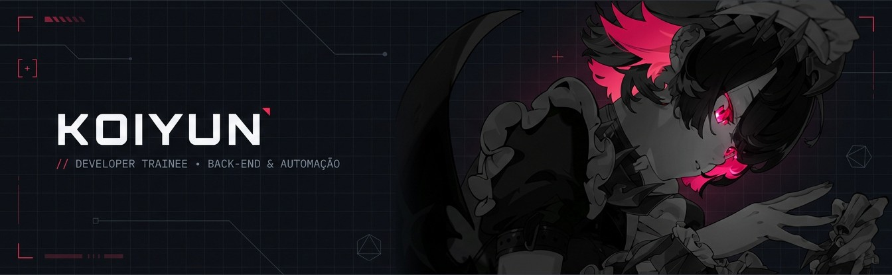
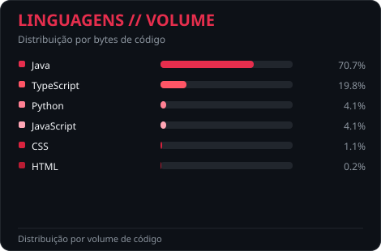

<!--
  ============================================================
  MOISÉS // GITHUB PROFILE
  VERSION: 1.0
  USERNAME: moisesssbarbosa
  THEME: ZENLESS ZONE ZERO / ELLEN JOE

  CODE // AUTOMATE // BUILD // LEARN

  Assets: ./assets/
  ============================================================
-->

<!-- Crie um banner no Affinity com a Ellen Joe (preto, branco e detalhes em vermelho) e salve como banner-ellen.png -->

 

<!-- SYSTEM STATUS: FOUR-COLUMN GRID -->

<table width="100%">
<tr>
<td width="25%" align="center"></td>
<td width="25%" align="center"></td>
<td width="25%" align="center"></td>
<td width="25%" align="center"></td>
</tr>
</table>

<!-- ANIMATED INTRODUCTION -->

 

<!-- QUICK ACCESS -->

 

  QUICK NAVIGATION // SELECT A DESTINATION
    
  
  
  
  
  

 

<!-- ======================================================= -->
<!-- 01 // AGENT DOSSIER                                      -->
<!-- ======================================================= -->

## `01 // AGENT DOSSIER` IDENTITY & BACKGROUND

<table width="100%">
<tr>

<td width="45%" valign="top">

<h3>🦈 Operator Information</h3>

<pre><code>const operator = {
  name: "Moisés Barbosa",
  github: "moisesssbarbosa",
  role: "Backend & Systems Developer",
  focus: [
    "Java",
    "SQL & Databases",
    "Software Architecture",
    "Design & Vectors"
  ],
  status: "Learning & Building"
};</code></pre>

</td>

<td width="55%" valign="top">

<h3>⚡ About the Operator</h3>

Olá! Seja bem-vindo ao meu perfil no GitHub.

Sou um desenvolvedor em formação, focado em entender a fundo a lógica de programação, arquitetura de sistemas backend e manipulação de dados com <b>Java</b> e bancos relacionais.

Acredito que a melhor forma de aprender é construindo projetos práticos, estruturando o código do zero e aplicando atenção aos detalhes — tanto no código quanto na identidade visual dos projetos.

<b>Current objective:</b> 
Dominar fundamentos sólidos de engenharia de software e consolidar meu portfólio de sistemas.

</td>

</tr>
</table>

> 🦈 **Código limpo, lógica estruturada e café gelado.**

 

<!-- ======================================================= -->
<!-- 02 // TECH ARSENAL                                       -->
<!-- ======================================================= -->

## `02 // TECH ARSENAL` LANGUAGES, FRAMEWORKS & TOOLS

### `PRIMARY TECHNOLOGIES`

 

<table width="100%">
<tr>
<td width="50%" valign="top">
  <h3>💻 Core Development</h3>
  <ul>
    <li><b>Linguagem Principal:</b> Java</li>
    <li><b>Paradigmas:</b> Orientação a Objetos (POO), Estruturas de Dados</li>
    <li><b>Ferramentas:</b> VS Code, Git, GitHub Actions</li>
  </ul>
</td>
<td width="50%" valign="top">
  <h3>🗄️ Persistence & Design</h3>
  <ul>
    <li><b>Bancos de Dados:</b> PostgreSQL, MySQL, SQL</li>
    <li><b>Design Gráfico:</b> Affinity Designer (Vetores e Identidade Visual)</li>
    <li><b>Ambiente:</b> Linux / Bash</li>
  </ul>
</td>
</tr>
</table>

 

<!-- ======================================================= -->
<!-- 03 // CURRENT MISSIONS                                   -->
<!-- ======================================================= -->

## `03 // CURRENT MISSIONS` PROJECTS & EXPERIMENTS

SELECTED WORK // SYSTEMS & CODE EXPERIMENTS

 

<table width="100%">
<tr>
<td width="50%" valign="top">
  <h3>☕ Java Backend Systems</h3>
  
Desenvolvimento de aplicações em Java focadas em regras de negócio bem definidas, arquitetura limpa e manipulação eficiente de dados.

  <code>Java</code> <code>OOP</code> <code>Logic</code>
    
  
</td>
<td width="50%" valign="top">
  <h3>📊 Database Architecture</h3>
  
Modelagem relacional de dados, otimização de consultas SQL e integração com sistemas locais e remotos.

  <code>PostgreSQL</code> <code>MySQL</code> <code>SQL</code>
    
  
</td>
</tr>
</table>

 

<!-- ======================================================= -->
<!-- 04 // GITHUB STATS                                       -->
<!-- ======================================================= -->

## `04 // GITHUB STATS` ACTIVITY & METRICS

  Gráficos gerados automaticamente pelo script em Python via GitHub Actions.

 

<table width="100%">
  <tr>
    <td width="100%" align="center" valign="top">
      
    </td>
  </tr>
</table>

<table width="100%">
  <tr>
    <td width="50%" align="center" valign="top">
      
    </td>
    <td width="50%" align="center" valign="top">
      
    </td>
  </tr>
</table>

 

<!-- ======================================================= -->
### 05 // CONNECTIONS
<!-- ======================================================= -->

## `05 // CONNECTIONS` FIND ME ONLINE

  FIND ME AROUND THE INTERNET
    
  
    
  
  

 

  Profile inspired by Zenless Zone Zero and Ellen Joe.
    
  

<!-- END OF PROFILE -->
